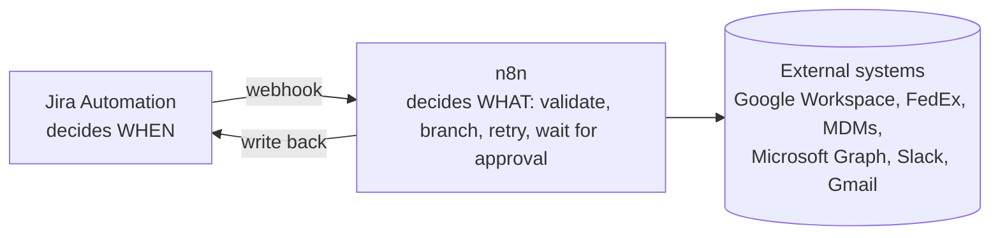

# IT Lifecycle & Automation Portfolio

Architecture write-ups for an IT operations automation stack: **employee onboarding and offboarding, asset management, and AI-assisted service desk triage and reporting.**

> **Note:** Everything here is generalized. The organization is fictional ("ExampleCo"), people and addresses are samples, and system identifiers are omitted. The architecture, design decisions, and trade-offs reflect real production work.

## The pattern

Almost every workflow here follows one shape:

**Jira owns the event. n8n owns the orchestration. The systems of record own the truth.** Humans stay in the loop for anything irreversible.

## Contents

### Onboarding
| Write-up | What it does |
|----------|--------------|
| [Role-based provisioning](docs/onboarding/role-based-provisioning.md) | One approved ticket → accounts, OU, device groups, and role-based app access |
| [Welcome email orchestrator](docs/onboarding/welcome-email-orchestrator.md) | Routes by employment type, attaches the right setup guides, confirms in Slack |
| [Password reset + 2SV reminder](docs/onboarding/password-reset-and-2sv-reminder.md) | Fast access recovery with a self-expiring security exception |

### Offboarding
| Write-up | What it does |
|----------|--------------|
| [Timed deprovisioning](docs/offboarding/timed-deprovisioning.md) | Removes access at the exact separation minute, behind a double approval |
| [Equipment return (RMA + QR)](docs/offboarding/equipment-return-rma.md) | Address validation, carrier RMA, QR code, and a branded email draft |
| [Manual return fallback](docs/offboarding/manual-return-fallback.md) | Same outcome when the employee's account is already gone |
| [Office notifications](docs/offboarding/office-notifications.md) | Location-gated departure checklist for office managers |

### Asset management
| Write-up | What it does |
|----------|--------------|
| [System scope & schema](docs/asset-management/system-scope-and-schema.md) | One system of record for every managed device |
| [MDM sync workflows](docs/asset-management/mdm-sync-workflows.md) | Idempotent nightly imports from three MDM platforms |
| [Asset Finder](docs/asset-management/asset-finder-lookup-and-link.md) | Finds a person's devices and links them to tickets both ways |
| [Lifecycle status automation](docs/asset-management/lifecycle-status-automation.md) | Request-driven state changes with an embedded audit trail |

### AI agents & reporting
| Write-up | What it does |
|----------|--------------|
| [AI triage & overflow routing](docs/ai-and-reporting/triage-overflow-routing.md) | Agent classifies, explains risk, and summarizes; routing stays deterministic |
| [SLA metrics reports](docs/ai-and-reporting/sla-metrics-reports.md) | Daily AI-assisted reports, and how I made LLM JSON output reliable |

### Infrastructure
| Write-up | What it does |
|----------|--------------|
| [Directory lookup service](docs/infrastructure/directory-lookup-service.md) | Read-only, least-privilege Cloud Run API for directory verification |

## Also in this repo

- [`templates/`](templates): three hand-built responsive HTML email templates (welcome, equipment return, office departure)
- [`samples/`](samples): small, tested JavaScript samples of logic used in these workflows (`node --test` to run)

## Design principles that recur

1. **Idempotent writes.** Look up by a unique key before create or update, so re-runs are safe.
2. **Human gate before irreversible actions.** Automation prepares; people approve.
3. **Fail loudly, with a next step.** Every error path posts somewhere with a link or a reason.
4. **Validate before you act.** Check addresses, payloads, and fields before calling external APIs.
5. **Don't trust LLM output.** Constrain it with worked examples, then parse, validate, and recompute.
6. **Document the gaps.** Each write-up lists known limitations and next steps.

## Tech

Jira Service Management · Jira Automation · JSM Assets (AQL) · n8n · Atlassian Rovo · BetterCloud · Google Workspace Admin SDK · Google Cloud Run · Microsoft Graph / Intune / Entra ID · Kandji (Iru) · MaaS360 · FedEx APIs · Slack · Gmail · JavaScript · Python

## License

[MIT](LICENSE). Use anything here, just keep the notice.
