# Morning & Evening SLA Metrics Reports

**Domain:** AI agents · Reporting  
**Platforms:** Jira Automation, Atlassian Rovo agent, n8n, Gmail, QuickChart  
**Status:** Active (two reports, one pipeline)

Daily HTML email digests of service-desk SLA health. The **morning** report also proposes a game plan; the **evening** report closes the day and lists breaches carrying over.

## Pipeline

```mermaid
flowchart LR
    A[Jira scheduled rule: query tickets] --> B[Rovo agent: use agent action]
    B -->|one JSON object as raw text| C[Send web request: POST as text/plain]
    C --> D[n8n webhook]
    D --> E[Parse and validate JSON]
    E --> F[Build HTML row blocks]
    F --> G[Build chart URLs]
    G --> H[Inject into email template]
    H --> I[Gmail send]
```

The request is sent as `text/plain`, **not** `application/json`, so the agent's raw text arrives untouched and n8n does its own parsing.

## Morning vs. evening

| | Morning | Evening |
|-|---------|---------|
| Scope | All open tickets | Open tickets plus those resolved in the last 24h |
| Extras | Strategy: reassignments, priority focus (top 5), quick wins (top 3) | Resolved list and carry-over breaches |
| JSON keys | 10 top-level | 9 top-level |
| Chart 1 | SLA breakdown pie | End-of-day disposition pie |
| Chart 2 | Load by assignee (open vs. breached) | Assignee activity (resolved, open, breached) |
| Subject emoji | Status from breach/at-risk counts | 🔴 if any carry-over breaches, else ✅ |

## Definitions the agent applies

- **Breached:** SLA clock ran out and the goal wasn't met
- **At risk:** under 2 hours remaining and not yet breached
- **TTFR:** time to first response, creation to first agent comment
- **TTR:** time to resolution
- **Compliance:** `met ÷ (met + breached [+ at risk]) × 100`, rounded

## Strategy rules (morning)

- **Reassign** only if the assignee has 2+ breaches and a teammate has fewer than half their open count; or the ticket is unassigned; or a breach has sat 4+ hours and its assignee has 5+ open tickets.
- **Priority focus:** up to 5 tickets, ranked by breach severity, priority field, and whether a first response would stop the clock.
- **Quick wins:** up to 3 tickets likely closeable today.

## Making LLM output dependable

**Schema drift was the main failure.** The first prompt described the schema with abstract placeholders (`<ticket key>`). The agent invented top-level keys, flattened nested objects, renamed fields, and replaced per-ticket arrays with aggregate counts.

**The fix:** replace the abstract schema with a **fully filled-in worked example**, plus an explicit "exactly these keys, nothing renamed" checklist. Models copy structure from concrete examples far more reliably than from descriptions.

Other guardrails in the prompt:
- No markdown mention links in name fields (source data sometimes contains `[Name](/people/...)`)
- No text outside the JSON object: no preamble, no code fences
- A constrained enum (`sla_status` is exactly `Met` or `Breached`)
- Tone rules tied to metrics for the comedic summary blurb (blunt below 50% compliance, encouraging at 95%+ with zero breaches), and never a personal dig at a named assignee

## Defense in depth on the n8n side

- **Parse & validate:** strip code fences anywhere, extract from the first `{` to the last `}`, `JSON.parse`, and throw if a required key is missing. See [`samples/validate-agent-json.js`](../../samples/validate-agent-json.js).
- **Row builders use `pick(obj, [aliases], fallback)`.** Alternate field names are accepted, and missing values render as `—` instead of `undefined`.
- **Neutral badge on missing status.** A missing `sla_status` shows a neutral badge, not a red "Breached".
- **Recompute, don't trust.** The evening workflow recalculates compliance from raw met/breached counts instead of displaying the agent's percentage, so the figure is always consistent with the counts beside it.
- **Charts as images.** Gmail strips scripts, so charts are QuickChart image URLs embedded as ``.

## A scoping bug worth remembering

A JQL scoping defect had been silently excluding resolved work from the metrics. The evening report's query is now explicitly scoped to tickets that are open *or* resolved in the last 24 hours.
