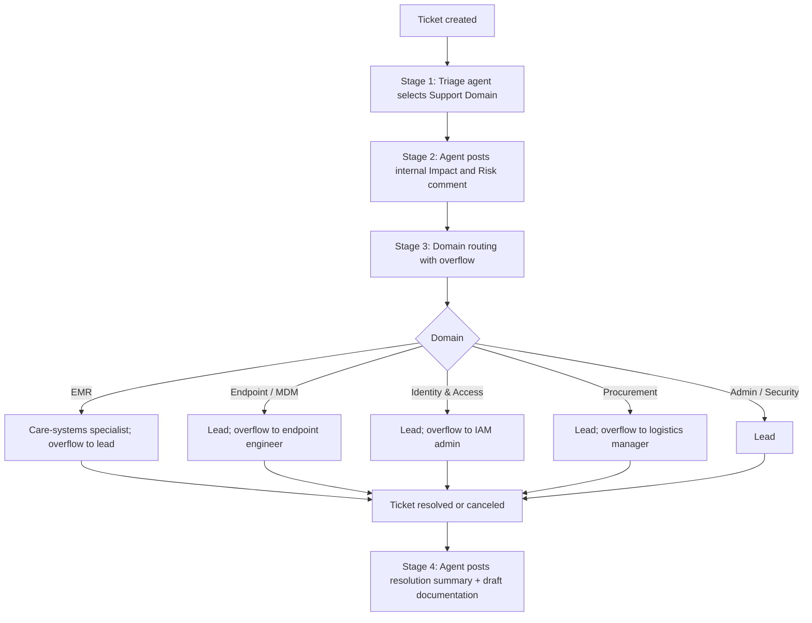

# AI Triage & Overflow Delegation

**Domain:** AI agents · Service desk automation  
**Platforms:** Jira Service Management, Jira Automation, Atlassian Rovo agent  
**Status:** Active

A four-stage automation chain that classifies every new ticket with an AI agent, explains its impact and risk, routes by domain with workload-aware overflow, and documents the resolution afterward.

The routing model mirrors how the team really works rather than a flat round-robin: one **Help Desk Lead** is the cross-domain systems administrator and primary owner of everything, while **domain specialists** only receive work when the lead's workload crosses a threshold.

## Pipeline

## Stage 1: Domain classification

On ticket creation the rule waits briefly, then the triage agent reads the description and selects one value from a single-select **Support Domain** field (EMR systems, endpoint and MDM, identity and access, SaaS applications, hardware, security, major incident, service request, procurement). That field is the **routing key** for everything downstream.

## Stage 2: Impact and risk

The agent posts an internal comment with impact and risk analysis, giving the assignee context and a starting point for troubleshooting before they open the ticket.

## Stage 3: Domain routing with overflow

| Domain | Primary | Rule |
|--------|---------|------|
| EMR / care systems | Care-systems specialist | Specialist workload 0–4 → specialist; 5+ → lead |
| Endpoint & MDM | Lead | Lead workload 0–9 → lead; 10+ → endpoint engineer |
| Identity & Access | Lead | Lead workload 0–9 → lead; 10+ → IAM admin |
| Procurement | Lead (assets & logistics) | Lead workload 0–9 → lead; 10+ → logistics manager |
| Admin / Security | Lead | Always lead |

Specialists receive nothing until overflow occurs; the lead is the safety net across every domain.

## Stage 4: Resolution intelligence

When a ticket moves to Resolved or Canceled, the agent analyzes worklogs, time spent, change history, and resolution time. It posts a summary of the steps taken and generates documentation for future troubleshooting.

## Queues are a read layer

Eleven JQL queues are organized by criticality, operational domain, and lifecycle. Automation owns **assignment**; queues own **visibility**. Nobody sorts a queue to decide who works what.

## Design notes

- **One classification field drives the whole chain.** Changing a routing rule means changing one branch, not rewriting the system.
- **Workload thresholds encode real capacity**, not an idealized rotation.
- **AI used where it's strong** (reading unstructured text, summarizing history) while routing stays deterministic and auditable.
- **Prompt engineering lesson:** an agent prompt that said both "use judgment" and "don't invent facts" produced inconsistent output until the conflict was diagnosed and the prompt rewritten. See [SLA metrics reports](sla-metrics-reports.md) for the structured-output version of the same lesson.
