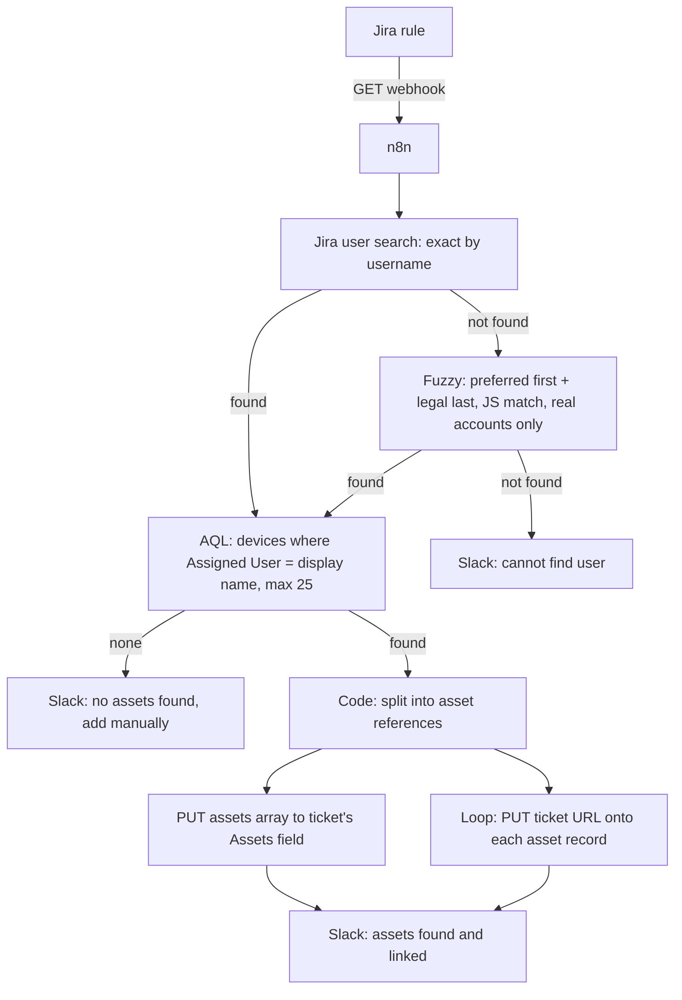

# Asset Finder: Lookup and Link

**Domain:** Asset management · Onboarding and offboarding  
**Platforms:** Jira Automation, n8n, Jira REST API, JSM Assets (AQL), Slack  
**Status:** Active (two Jira rules, one shared n8n workflow)

Finds every device assigned to a person, links them to the lifecycle ticket, and stamps each device record with the ticket URL, so IT never hunts for equipment by hand.

## Entry points

| Rule | Trigger | Scope |
|------|---------|-------|
| **Asset Finder [Onboard]** | Scheduled weekly (Mon and Tue, 7:00 AM Central); a JQL branch finds onboarding tickets in `Review` | The four onboarding request types |
| **Asset Finder [Offboard]** | Status transition `Waiting for Termination Date → In Progress` | Normal, immediate, contractor, and executive offboarding |

The onboarding rule runs early in the week to catch new hires starting that week, giving IT time to confirm enrollment and compliance. The offboarding rule is event-driven, so it fires the moment the ticket goes active.

**Payload (minimum necessary):** issue key, username, and name fields.

## Flow

## Details

**Two-step user mapping.** Jira user search returns a `displayName`, and the AQL query matches the Assets *Assigned User* attribute by that display name. (Account ID and email caused the AQL to fail, so display-name consistency is a documented operational requirement.)

**Fuzzy fallback priority:** exact display name → all name parts present → first real, non-service account. This handles new hires whose username isn't yet active in Jira.

**AQL scope:** object types Windows, MacBooks, iPhones, Android phones, iPads, Android tablets, `Assigned User = "<display name>"`, up to 25 results.

**Normalization step.** The Assets API may return a `values` array or already-split items. A code node converts both into the shape Jira expects: `{ "id": "<workspaceId>:<objectId>" }`.

**Bidirectional linking.** The ticket gets the asset list; each asset gets the ticket URL. Any device can be traced back to the ticket that touched it.

**Three Slack outcomes:** assets found, no assets found, and user not found, each with an actionable message.

## Operational requirements

- The username field must be searchable in Jira.
- Assigned User in Assets must match the Jira display name exactly.
- The ticket's Assets field must remain multi-value.

## Limitations / next steps

- Display-name matching is brittle; resolving through an account-ID attribute would be sturdier.
- Cap of 25 results per person.
