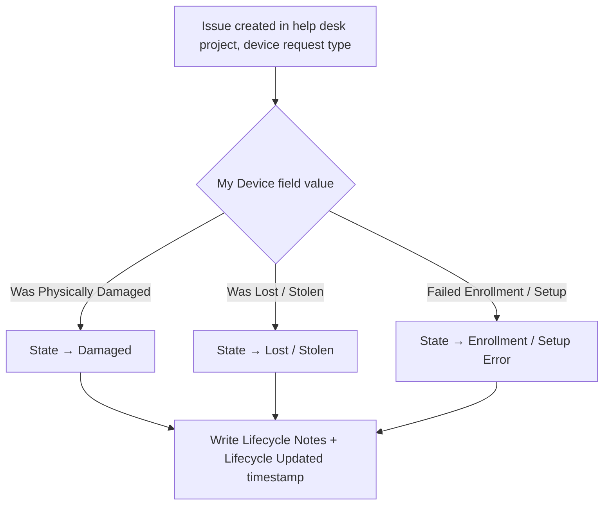

# Asset Lifecycle Status Automation

**Domain:** Asset management  
**Platforms:** Jira Cloud Automation, JSM Assets  
**Status:** Active

When someone reports a device problem, the linked asset's lifecycle state updates itself, with an audit trail embedded in the record.

## Flow

## Behavior

The rule edits three attributes on the linked asset via the Assets field action. Each reported condition maps to exactly one state.

| Attribute | Value |
|-----------|-------|
| **Lifecycle State** | Mapped from the reported condition |
| **Lifecycle Notes** | `<issue key> - Lifecycle changed to <state> by <reporter> on <timestamp>` |
| **Lifecycle Updated** | Current timestamp |

The notes attribute records who triggered the change, from which ticket, and when.

## Requirements

- The issue has a populated *My Device* field referencing a valid asset.
- The automation actor has browse project, edit issue, and Assets object edit permissions.
- The Lifecycle State, Notes, and Updated attributes exist in the schema.

## Position in the architecture

Complements the [MDM sync workflows](mdm-sync-workflows.md): syncs ingest devices and set *Active*; this rule manages the lifecycle afterward.

## Limitations and next steps

- Triggers on issue creation only, not on status transitions
- No reverse transitions (e.g., Lost → Active)
- No approval gating or validation
- No reassignment logic
- No decommission cascade
