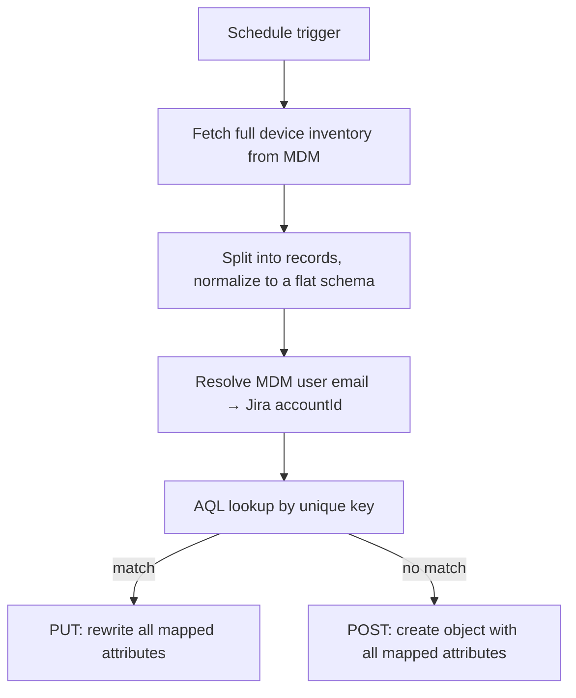

# MDM → Jira Assets Sync Workflows

**Domain:** Asset management  
**Platforms:** n8n, Jira Assets (REST + AQL), Kandji/Iru API, Microsoft Graph, MaaS360 API  
**Status:** macOS and Windows active; MaaS360 mobile syncs deprecated after MDM consolidation

Three platform-specific n8n workflows share one pattern: nightly, idempotent imports of device inventory into Jira Assets.

## The shared pattern

| Principle | Implementation |
|-----------|----------------|
| **Idempotent** | A unique-key lookup precedes every write, so re-runs never duplicate. Keys per device type: [System scope & schema](system-scope-and-schema.md) |
| **Source-of-truth alignment** | MDM values overwrite asset values on update |
| **Normalization layer** | Nested API responses are flattened to a fixed schema, so attribute mappings survive vendor schema changes |
| **Fault tolerance** | Create and update nodes continue on error; one bad record doesn't stop the run |
| **Non-blocking user mapping** | If no Jira user matches an email, the device is still synced |

## Per-platform notes

### macOS: Kandji / Iru

- `GET /api/v1/devices` returns all enrolled devices with nested user, MDM status, and agent status.
- No API-side filtering; validation happens downstream.
- Also maps a User Active Status attribute.

### Windows: Entra ID / Intune

- Microsoft Graph `deviceManagement/managedDevices`, filtered to `operatingSystem eq 'Windows'` at the API level.
- Fields: device name, serial, model, OS version, last sync, user principal name, compliance state, management state, registration state.
- Compliance state is carried into the asset so reporting can query it.

### Mobile: MaaS360 (deprecated)

- XML authentication call returns a token reused for the run.
- Device search, then filter by platform and device type (e.g., iOS + Smartphone, or Tablet).
- Compliance fetched per device from a separate endpoint and mapped into Assets.
- Retired when mobile devices were consolidated into the other two MDMs.

## Operational requirements

- Serial number must stay unique in Assets.
- Assigned User attribute: type User, cardinality 1.
- Date attributes must match the Assets date format.
- Attribute IDs are referenced by the workflow; renumbering requires updating it.
- API credentials (e.g., Graph app permissions) must stay valid and unexpired.

## Limitations and next steps

- No delta sync (full pull each run)
- No retirement logic for devices removed from an MDM
- No change history
