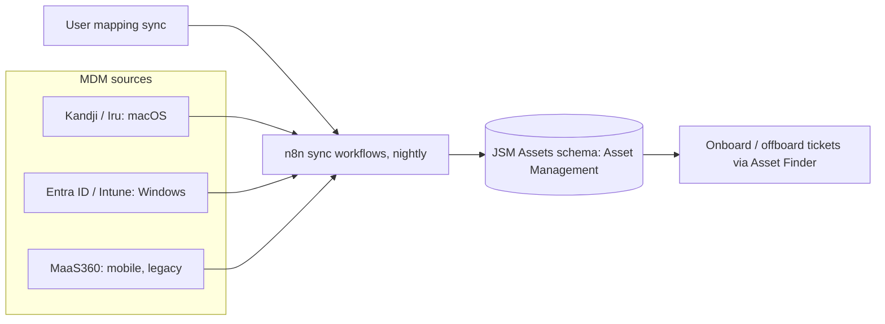

# Asset Management System: Scope & Schema

**Domain:** Asset management  
**Platforms:** Jira Service Management Assets, n8n, Kandji/Iru, Microsoft Intune/Entra ID, MaaS360  
**Status:** Active

A single queryable system of record for every MDM-managed device, populated automatically and refreshed nightly.

## Architecture

## Device scope

| Device type | MDM source | Unique key |
|-------------|-----------|------------|
| MacBooks | Kandji / Iru | Serial Number |
| Windows laptops | Entra ID / Intune | Serial Number |
| iPhones | MaaS360 (legacy) | IMEI |
| Android phones | MaaS360 (legacy) | IMEI |
| iPads | MaaS360 (legacy) | MDM device UID |
| Android tablets | MaaS360 (legacy) | n/a |

**Out of scope:** peripherals, software licenses, accessories, non-MDM-managed devices.

## Deduplication via AQL

Every query is scoped to the **Asset Management** object schema. Without that scope, queries can match objects in legacy schemas and create duplicates.

Example: `objectType = "Windows" AND objectSchema = "Asset Management" AND "Serial Number" = "<value>"`

## Ownership model

| Property | Rule |
|----------|------|
| Assigned User | Internal Jira users only. Customer-portal accounts are filtered out. |
| Owner source | MDM user email resolved to a Jira account ID via user search |
| Unassigned devices | Allowed. Assigned User stays blank and no lifecycle state is auto-set. |

## Lifecycle states

Active · Stored Inventory · In Repair · Damaged · Lost / Stolen · Enrollment / Setup Error · Decommissioned · Retired

When a sync populates Assigned User with a valid internal account ID, Lifecycle State is set to **Active** automatically. See [lifecycle status automation](lifecycle-status-automation.md) for the request-driven states.

## Shared hardware attributes

Name · Assigned User · Model · OS Version · Last Check-in · Linked lifecycle ticket · IMEI (mobile) · MDM device ID (mobile) · MDM / Compliance status · Serial number (primary dedup key for laptops) · Lifecycle State

Compliance status is sourced per platform: Entra compliance for Windows, Kandji active status for macOS, MaaS360 compliance for mobile.

## Schedule

The user-mapping sync runs **first** each day so account IDs are resolved before any device sync. Device syncs then run nightly at midnight.

## Success criteria

- 100% of MDM-managed devices visible in Assets
- ≥95% attribute accuracy
- Zero duplicates per serial / IMEI / device ID
- Lifecycle State = Active for assigned devices within 24 hours of sync
- Assigned User populated for every device with a valid MDM email matching an internal account
- Status updates triggered from Jira automation
- Service desk UAT sign-off

## Limitations and next steps

See [MDM sync workflows](mdm-sync-workflows.md#limitations-and-next-steps).
