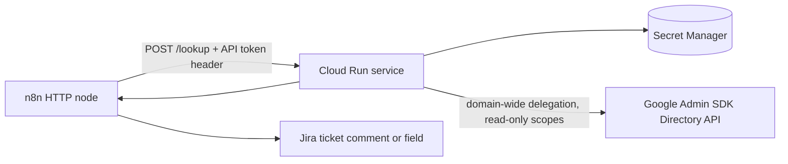

# Directory Lookup Service

**Domain:** Infrastructure · Identity  
**Platforms:** Google Cloud Run (Python/Flask), Google Admin SDK, Secret Manager, n8n  
**Status:** Active

A small, serverless, read-only API that returns a user's directory profile so automations can verify access without each one holding admin credentials.

## Purpose

Confirm Workspace access removal during offboarding by pulling authoritative directory data at ticket-closure time and attaching it to the Jira ticket as evidence.

**Returns (read-only):** display name, primary email, organizational unit, group memberships.

## Architecture



## Identity & security model

The service intentionally separates **runtime identity** from **directory access identity**.

| Identity | Purpose | Notes |
|----------|---------|-------|
| **Admin SDK service account** | Reads Workspace directory via domain-wide delegation | Read-only scopes (users, groups, org units); key stored as a secret; used by app code only |
| **Cloud Run service account** | What the service can do in GCP | Dedicated, explicitly attached, no Admin SDK access; roles limited to Secret Accessor and Log Writer |

Result: clear ownership, minimal blast radius, clean audit logs, and an easy kill switch.

**Controls:** no public access (authenticated ingress only) · header-based API token on top of IAM · secrets only in Secret Manager, never in code or env files · no write access to Workspace.

## API

`POST /lookup`  
Headers: `Content-Type: application/json`, `X-API-TOKEN: <shared internal secret>`

```json
{ "targetUserEmail": "jordan.reyes@example.com" }
```

```json
{
  "name": "Jordan Reyes",
  "email": "jordan.reyes@example.com",
  "orgUnit": "/Employees",
  "groups": ["employees@example.com", "engineering@example.com"]
}
```

| Status | Meaning |
|--------|---------|
| 400 | Missing or invalid body |
| 401 | Missing or invalid API token |
| 404 | User not found (expected for deleted or suspended users) |
| 500 | Internal error (check logs, credentials, API enablement) |

## Using it for offboarding verification

1. Jira webhook fires on an offboarding status change
2. n8n extracts the employee email and calls `/lookup`
3. **User found** → flag for manual review. **404** → access removal confirmed
4. Verification result posted to the ticket

## Operations

- **Monitoring:** request count, latency, error rate, instance count; application logs of request cycles, auth failures, Google API errors
- **Maintenance:** rotate API tokens quarterly, review service-account permissions annually, monitor quotas, patch dependencies
- **Key rotation:** generate new key → update the secret → redeploy → revoke the old key after verification

## Cost

Request-based billing with a generous free tier (about 2M requests, 180k vCPU-seconds, 360k GiB-seconds per month). Admin SDK is free within quota. Estimated under $5/month for typical IT automation volume.

## Deploy (illustrative)

```bash
gcloud run deploy directory-lookup-service \
  --source . \
  --region us-central1 \
  --project <your-project-id> \
  --no-allow-unauthenticated
```
