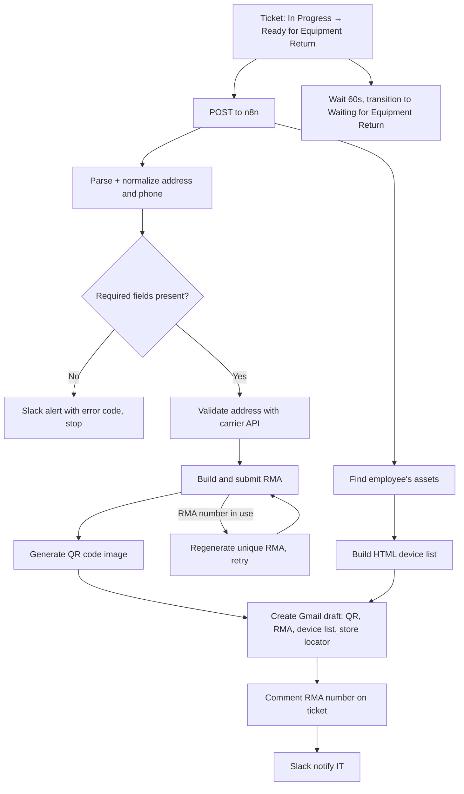
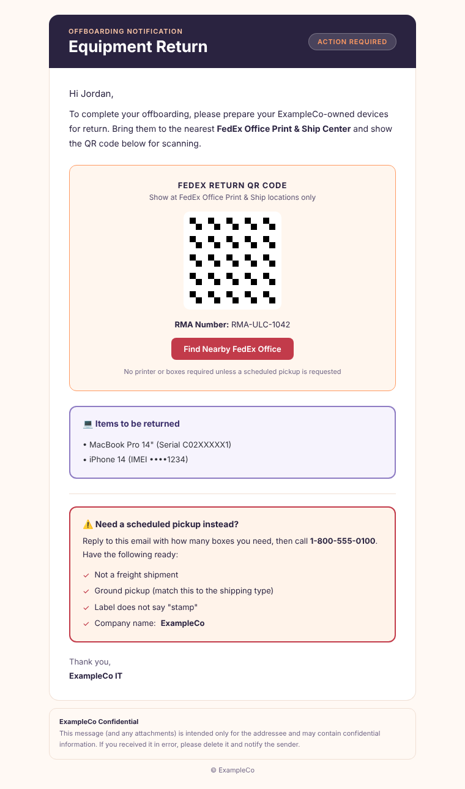

# Equipment Return: Carrier RMA + QR Pack-and-Ship

**Domain:** Employee lifecycle · Offboarding  
**Platforms:** Jira Automation, n8n, FedEx APIs (Address Validation, Returns), Gmail, Slack, quickchart.io  
**Status:** Active (third generation of the return workflow)

A status transition produces a complete carrier return: validated address, RMA, scannable QR code, and a branded email draft with the employee's device list. No manual label creation.

## Flow

## Design points

**Address parsing handles real-world input.** Custom code recognizes 14 address patterns: standard, unit/apartment variants, multi-line, hyphenated house numbers, and PO Box detection (carriers can't ship from them). Phone numbers are normalized to ten digits. A runnable simplified version is in [`samples/parse-address.js`](../../samples/parse-address.js).

**Validate before you create.** Required fields are checked locally, then the address is validated with the carrier's API *before* the RMA is created, so undeliverable addresses never produce failed RMAs.

**Duplicate RMA recovery.** If the carrier rejects an RMA number as already in use, the workflow regenerates one from the issue key plus a timestamp and retries.

**QR code instead of a printed label.** The employee scans a QR image at a carrier print-and-ship location, so no printer or box is required unless they request a pickup.

**Draft, not send.** The departure email is a Gmail **draft**; a person reviews and sends it.

**Status handoff.** Jira transitions the ticket itself after 60 seconds, so ticket state doesn't depend on n8n's response.

## Email

Branded banner with an "Action Required" badge, a QR code box with RMA number and store-locator button, a device list, and a scheduled-pickup checklist. See [`templates/equipment-return-email.html`](../../templates/equipment-return-email.html).

## Related

- [Manual fallback](manual-return-fallback.md) for when the employee's account is already gone.
- [Asset Finder](../asset-management/asset-finder-lookup-and-link.md) supplies the device list.
