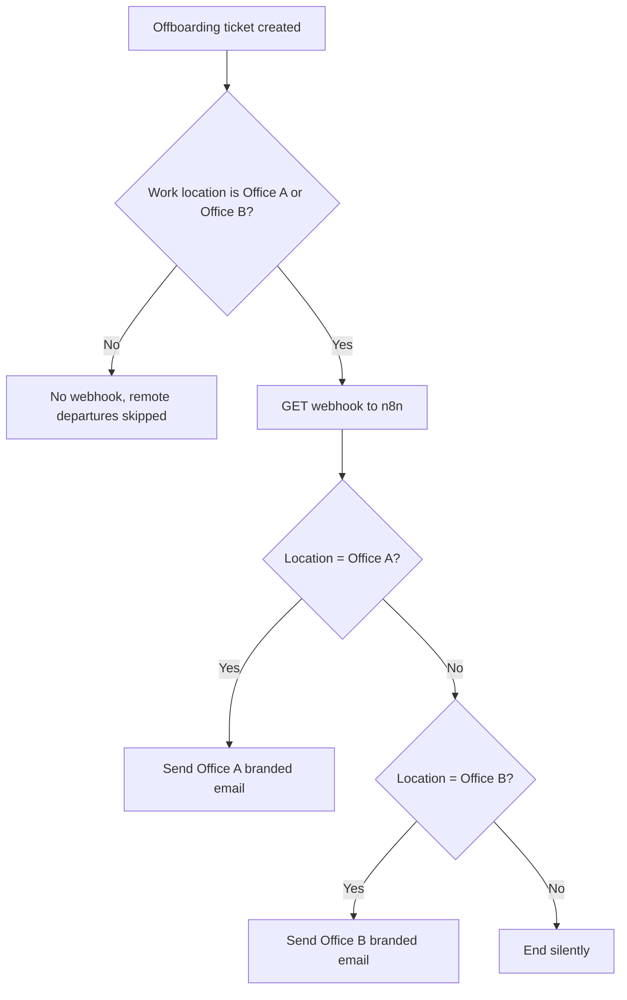
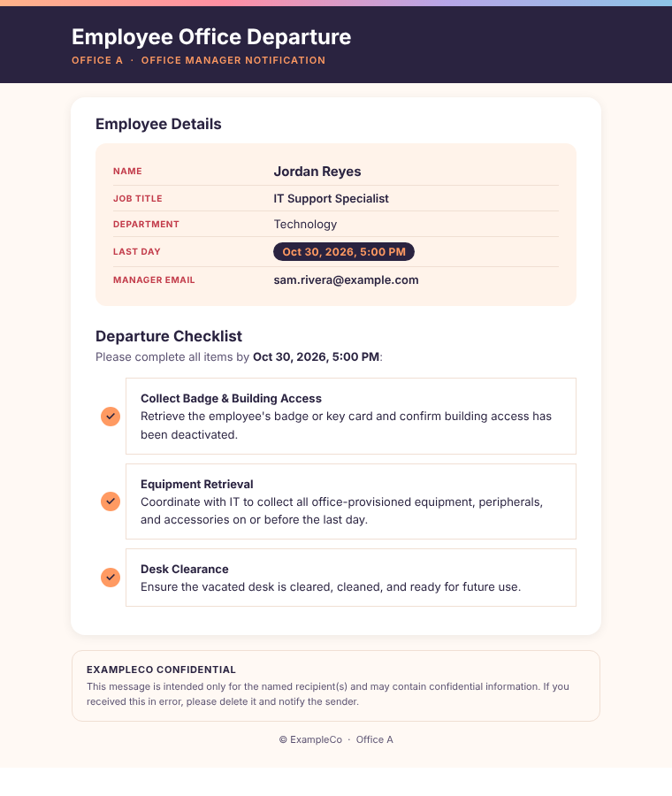

# Office Manager Notifications

**Domain:** Employee lifecycle · Offboarding  
**Platforms:** Jira Automation, n8n, Google service account (Gmail)  
**Status:** Active

Office managers are emailed the moment an in-office departure ticket is created, with no hand-off from IT or HR.

## Flow

## Details

- **Gating happens in Jira.** The rule's Work Location condition means remote employees never invoke n8n.
- **Payload:** preferred first name, legal last name, role, department, manager and manager email, separation date/time, work location.
- **Branded per site.** Each office gets its own header and footer.
- **Email contents:** employee name, title and department, last day formatted in the office's timezone, manager email, and a departure checklist:
  1. Collect badge and building access, and confirm access is deactivated
  2. Equipment retrieval, coordinated with IT, on or before the last day
  3. Desk clearance, so the desk is cleaned and ready for reuse

Template: [`templates/office-departure-email.html`](../../templates/office-departure-email.html)

## Limitations and next steps

- Adding a third office means another branch. A lookup table of site → branding would remove the duplication.
