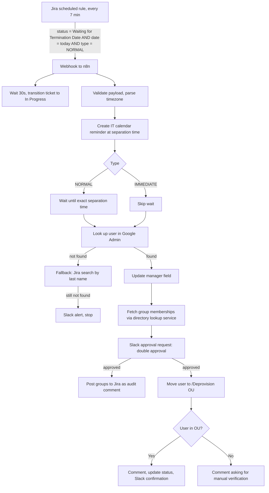

# Timed Deprovisioning with Human Approval

**Domain:** Employee lifecycle · Offboarding  
**Platforms:** Jira Automation, n8n, Google Workspace Admin, Google Calendar, Slack  
**Status:** Active

Removes Google Workspace access at the exact separation time, but only after a human has confirmed twice. The one irreversible action in the chain is always behind a checkpoint.

## Flow

## Key behaviors

| Behavior | Why |
|----------|-----|
| **Polling every 7 minutes** with a JQL filter on separation date or last working day | Catches the right day without per-ticket schedules |
| **Payload validation** (separation time and issue key required) | Bad data stops the run instead of silently skipping it |
| **Timezone parsing** from free-text values like `Pacific Time (GMT-7)` | Calendar entries and waits land at the correct local moment |
| **Calendar event** for IT at separation time | Visibility even if a Slack message is missed |
| **Wait** until the exact separation instant (UTC) | Access is removed at the right minute, not "sometime that day" |
| **Two-step lookup** (Google Admin, then Jira by last name, real accounts only) | Survives username mismatches |
| **Manager field update** before removal | Keeps the directory's org chart accurate after departure |
| **Group snapshot** posted to the ticket | Audit trail of access held at the moment of removal |
| **Double approval in Slack**, warning that this removes all Workspace access and locks devices | Human checkpoint before the irreversible step |
| **OU placement check** after the move | Never assumes the action worked |

Nothing is guessed: if neither system has the account, the run alerts and stops. Every state change leaves a Jira comment.

## Related

- The group snapshot comes from the [Directory Lookup Service](../infrastructure/directory-lookup-service.md).
- Device recovery continues in [Equipment Return](equipment-return-rma.md).
