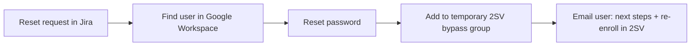
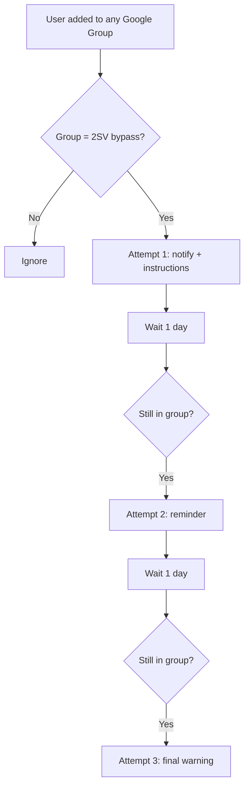

# Password Reset + 2-Step Verification Reminder

**Domain:** Employee lifecycle · Onboarding / access recovery  
**Platforms:** Jira Service Management, BetterCloud, Google Workspace  
**Status:** Active (two cooperating workflows)

A pair of workflows that restore access quickly for new hires, then make sure the temporary security exception doesn't linger.

## 1. New Hire Password Reset

- Starts only when a valid reset request exists.
- Targets the account by the username on the ticket.
- Temporarily bypasses 2-Step Verification so the first sign-in after a reset doesn't lock the user out. The bypass is time-bound and cleaned up elsewhere.

**Deliberately does not:** disable 2SV permanently, grant additional app access, or store or expose passwords.

## 2. 2SV Bypass Reminder

- Triggers on *any* group add, then filters, which catches every membership change without maintaining a list of target groups.
- Escalates over three attempts, one day apart, checking membership before each one.

**Deliberately does not:** remove the user from the group, re-enable 2SV, or suspend the account. Enforcement is left to separate workflows, so a reminder can never cause an outage.

## Why split it

Reset and reminder have different lifecycles. The reset is a one-shot action; the reminder is a long-lived watcher. Separating them keeps each small, testable, and easy to reason about during an audit.
