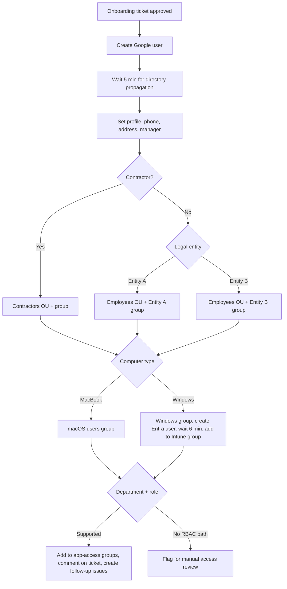

# Role-Based Account Provisioning

**Domain:** Employee lifecycle · Onboarding  
**Platforms:** Jira Service Management, BetterCloud, Google Workspace, Microsoft Entra ID  
**Status:** Active

One approved onboarding ticket becomes a provisioned, role-based, auditable user setup, with a fallback to manual review when automation can't decide.

## Flow

## Design

1. **Approval gate.** Nothing runs until the ticket reaches `Approved`.
2. **Propagation waits.** A 5-minute wait after Google user creation prevents race conditions in later directory calls. The Windows path waits again (6 minutes) after the Entra user is created, before adding the user to the Intune group.
3. **Group-based application access.** Department and role decide which Google Groups the user joins; SSO and SaaS apps key off those groups. Role paths in the model:
   - Engineering (software engineers get a wider set than other tech roles)
   - Data engineering and data analytics
   - Clinical / care teams (several sub-roles with different tool sets)
   - People / HR (recruiters vs. non-recruiters)
   - Marketing
   - Finance and actuarial
   - Product and design
4. **Audit trail.** Each branch comments on the Jira ticket, and most create follow-up issues and add watchers so the right team sees the outcome.
5. **Fallback.** If a department matches no supported RBAC path, the workflow comments, creates an issue, and adds a watcher, so a missing role definition surfaces as a work item instead of silently granting nothing.

Because each condition is evaluated independently, adding a role path doesn't disturb existing ones. Access is purely group membership, so offboarding and audits can reason about it the same way.

## Limitations and next steps

- Group lists are maintained inside the workflow. Moving the role-to-groups matrix into a data file would let non-engineers review it.
- The fallback creates a ticket but doesn't yet propose a likely role path.
