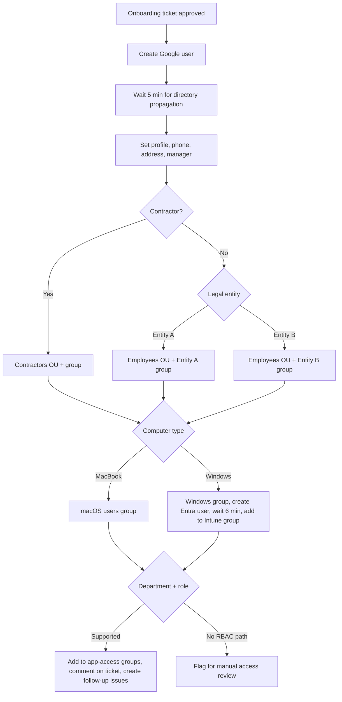

# Role-Based Account Provisioning

**Domain:** Employee lifecycle · Onboarding  
**Platforms:** Jira Service Management, BetterCloud, Google Workspace, Microsoft Entra ID  
**Status:** Active

One approved onboarding ticket becomes a fully provisioned, role-based, auditable user setup, with a safe fallback when automation can't decide.

## Flow

## Design

1. **Approval gate.** Nothing runs until the ticket reaches `Approved`.
2. **Account creation with a propagation wait.** A 5-minute wait after user creation prevents race conditions in later directory calls. The Windows path waits again (6 minutes) after the Entra user is created, before adding the user to the Intune group.
3. **Employment type decides the OU.** Contractors land in a Contractors OU and group. Employees land in the Employees OU plus a legal-entity group.
4. **OS decides device groups.** MacBook hires join a macOS group. Everyone else joins a Windows group and gets an Entra ID account for Intune enrollment.
5. **Department and role decide application access.** Access is granted by adding the user to Google Groups that SSO and SaaS apps key off. Role paths in the model:
   - Engineering (software engineers get a wider set than other tech roles)
   - Data engineering and data analytics
   - Clinical / care teams (several sub-roles with different tool sets)
   - People / HR (recruiters vs. non-recruiters)
   - Marketing
   - Finance and actuarial
   - Product and design
6. **Audit trail.** Each branch comments on the Jira ticket, and most create follow-up issues and add watchers so the right team sees the outcome.
7. **Fallback.** If a department doesn't match any supported RBAC path, the workflow comments, creates an issue, and adds a watcher, flagging the request for manual review instead of silently granting nothing.

## Why it works

- **Idempotent branching.** Each condition is evaluated independently, so adding a new role path doesn't disturb existing ones.
- **Least surprise.** Missing RBAC definitions are surfaced as work items, not failures.
- **Group-based access.** Access is a function of group membership, so offboarding and audits can reason about it the same way.

## Limitations / next steps

- Group lists are maintained inside the workflow. Moving the role-to-groups matrix into a data file would let non-engineers review it.
- The fallback creates a ticket but doesn't yet propose a likely role path.
