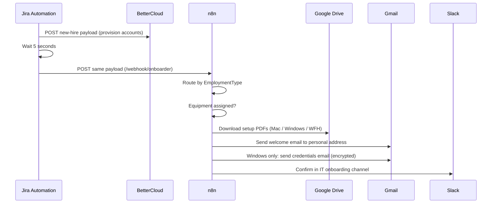
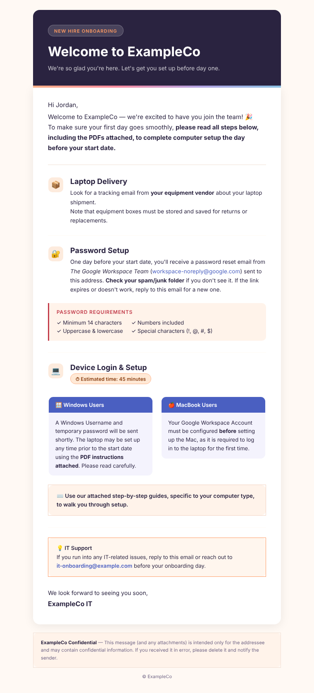

# Welcome Email Orchestrator

**Domain:** Employee lifecycle · Onboarding  
**Platforms:** Jira Automation, n8n, Gmail, Google Drive, Slack  
**Status:** Active (rebuilt in n8n; replaced a draft-only generator in Zapier)

When HR approves an onboarding ticket, one Jira rule provisions accounts and triggers an n8n workflow that routes by employment type and sends a personalized welcome email with the right setup guides attached.

## Flow

## Trigger

- Issue transitions **Awaiting Approval → Approved**.
- Condition: issue type and request type are one of four onboarding variants (employee or contractor, for each of two legal entities). This keeps the rule from firing on other tickets in the same project.

Payload (sent identically to both webhooks): preferred and legal name, start date, username, employment type, role, organization, department, manager email, home address, personal email, phone, computer choice, issue key, assignee, status, timezone.

## Steps

| # | Step | Purpose |
|---|------|---------|
| 1 | Approval transition detected | Only approved onboarding requests proceed |
| 2 | Provision accounts via BetterCloud | The account must exist before any email references it |
| 3 | 5-second buffer | Lets the account initialize before n8n runs |
| 4 | Trigger the n8n onboarder | n8n takes over routing and communication |
| 5 | Route by `EmploymentType` | Full-time employee, contractor (entity A), contractor (entity B) |
| 6 | Equipment check | If `ComputerChoice` is empty, take the no-equipment path |
| 7 | Fetch setup PDFs from Drive | Mac setup, Windows setup, or WFH equipment setup |
| 8 | Send the welcome email | HTML template to the new hire's personal address, PDFs attached |
| 9 | Windows credentials email (conditional) | Credentials go in a second, encrypted message, separate from the instructions |
| 10 | Slack confirmation | Closes the loop for IT |

## The email

A hand-built, responsive HTML template: header band, laptop-delivery notice, password-setup instructions with a requirements box, side-by-side Windows and Mac guidance, an estimated-time badge, an IT support block, and a confidentiality footer. See [`templates/welcome-email.html`](../../templates/welcome-email.html).

## Design notes

- **Jira owns the event; n8n owns the logic.** The rule only decides *when*. Branching, templating, and delivery live in n8n where they're testable.
- **Same payload to both systems** removes a class of mismatch bugs between provisioning and communication.
- **Personal-email delivery** is deliberate: the new hire doesn't have a work mailbox yet.
