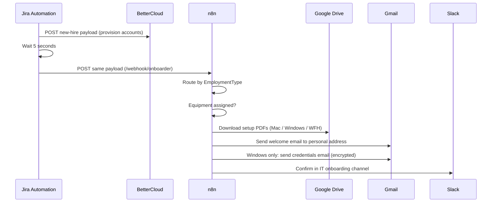

# Welcome Email Orchestrator

**Domain:** Employee lifecycle · Onboarding  
**Platforms:** Jira Automation, n8n, Gmail, Google Drive, Slack  
**Status:** Active (rebuilt in n8n; replaced a draft-only generator in Zapier)

When HR approves an onboarding ticket, one Jira rule provisions accounts and triggers an n8n workflow that sends a personalized welcome email with the right setup guides attached.

## Flow

## Trigger

- Issue transitions **Awaiting Approval → Approved**.
- Condition: issue type and request type are one of four onboarding variants (employee or contractor, for each of two legal entities). This keeps the rule from firing on other tickets in the same project.

Payload (sent identically to both webhooks): preferred and legal name, start date, username, employment type, role, organization, department, manager email, home address, personal email, phone, computer choice, issue key, assignee, status, timezone.

## Behavior

- **Provision first.** The account must exist before any email references it; a 5-second wait lets it initialize before n8n runs.
- **Routing.** `EmploymentType` selects full-time employee, contractor (entity A), or contractor (entity B). An empty `ComputerChoice` takes the no-equipment path.
- **Setup PDFs.** Mac, Windows, or WFH equipment guides are fetched from Drive and attached.
- **Credentials.** For Windows, credentials go in a second, encrypted message, separate from the instructions.

## The email

A hand-built, responsive HTML template with a laptop-delivery notice, password-setup instructions, side-by-side Windows and Mac guidance, an estimated-time badge, an IT support block, and a confidentiality footer. See [`templates/welcome-email.html`](../../templates/welcome-email.html).

## Design notes

- **Jira decides *when*; n8n owns branching, templating, and delivery** (see [the pattern](../../README.md#the-pattern)).
- **Same payload to both systems** removes a class of mismatch bugs between provisioning and communication.
- **Personal-email delivery** is deliberate: the new hire doesn't have a work mailbox yet.
